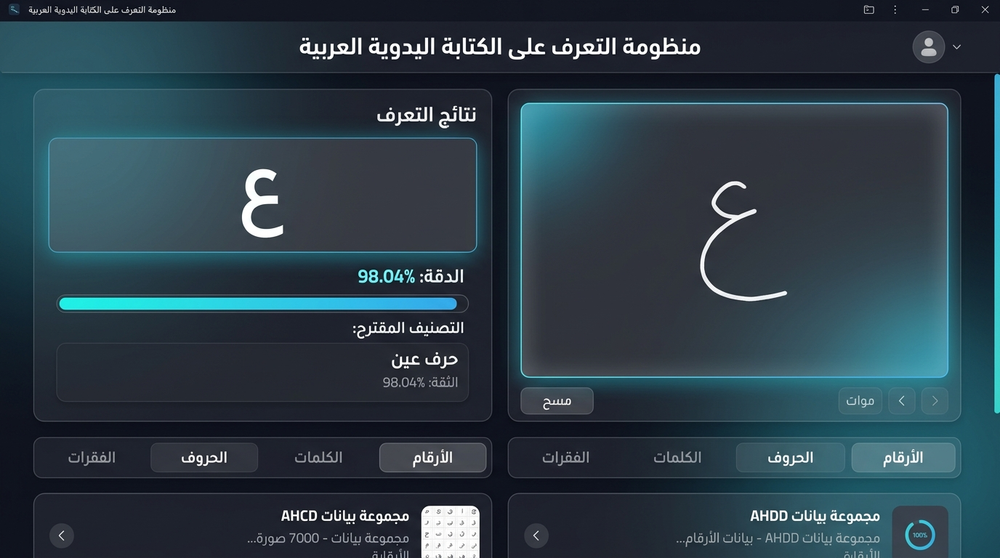
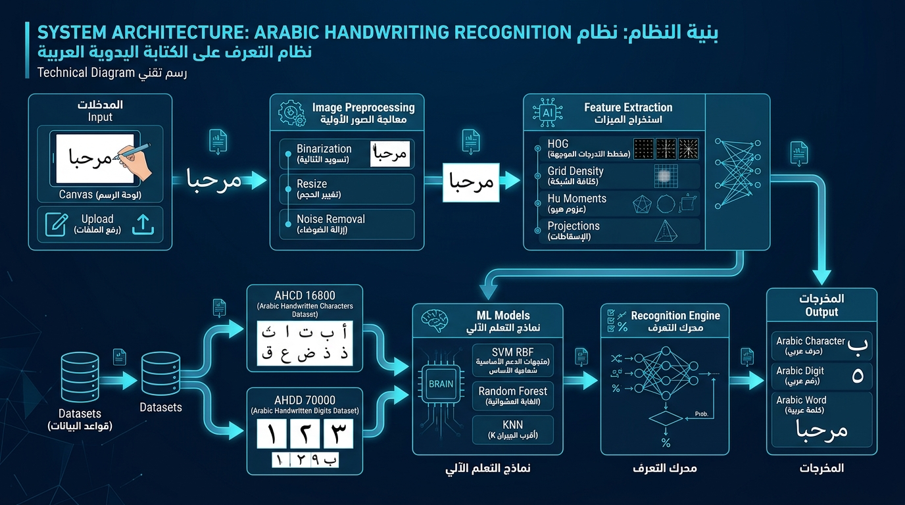
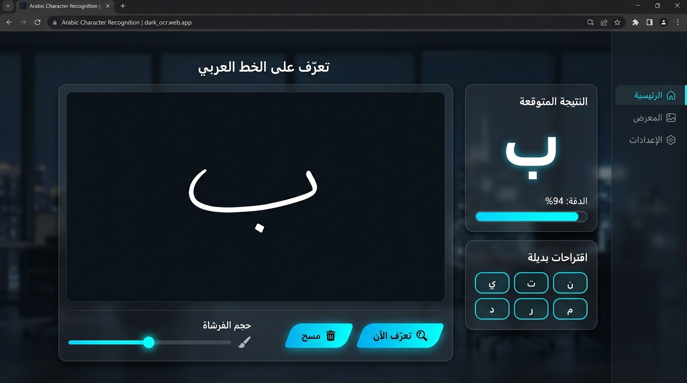
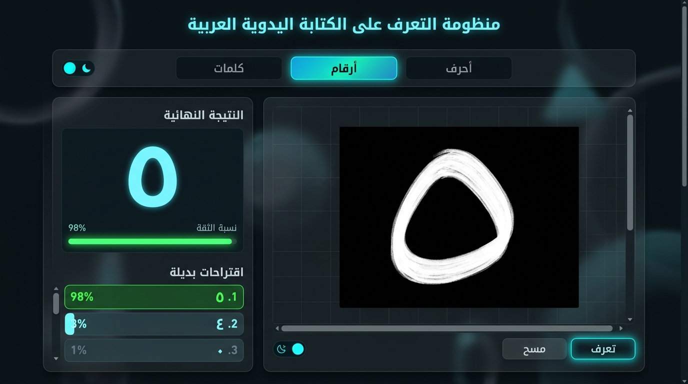

<div align="center">

# 🖋️ منظومة الذكاء الاصطناعي للتعرف على الكتابة اليدوية العربية
### Arabic Handwriting Recognition & Intelligent OCR Platform
#### (نظام إنتاجي قائم حصرياً على تعلم الآلة الكلاسيكي التقليدي — Zero Deep Learning)

[](https://python.org)
[](https://github.com)
[-success?style=for-the-badge&logo=scikit-learn)](https://github.com)
[](https://github.com)
[](https://github.com)
[](https://github.com)

<p align="center">
  <strong>منظومة إنتاجية متكاملة لمعالجة واستخراج الميزات والتعرف على الحروف والأرقام والكلمات والفقرات العربية المكتوبة بخط اليد، باستخدام تعلم الآلة التقليدي فقط بدون أي شبكات عصبية عميقة.</strong>
</p>

</div>

---

## 🖥️ معاينة واجهة التطبيق

<div align="center">
  
  <br>
  <em>واجهة التطبيق التفاعلية — تدعم الرسم الحي ورفع الصور مع اختيار وضع التعرف (أرقام/حروف/كلمات/فقرات)</em>
</div>

---

## 🏗️ المعمارية الهندسية للنظام

<div align="center">
  
  <br>
  <em>خط أنابيب المعالجة: الإدخال → المعالجة الأولية → استخراج الميزات → نماذج التعلم الآلي → محرك التعرف → المخرجات</em>
</div>

---

## 🎨 عروض توضيحية للتعرف

<div align="center">
  
  
  <br>
  <em>يسار: التعرف على حرف عربي مرسوم يدوياً — يمين: التعرف على رقم عربي بدقة 98%</em>
</div>

---

## 📊 نتائج تدريب النماذج (Model Benchmarks)


تم تدريب واختبار النماذج الكلاسيكية على **جميع مجموعات البيانات الحقيقية**:

### نموذج الأرقام (AHDD — 70,000 عينة)
| النموذج | المعلمات | دقة الاختبار | حالة الاعتماد |
| :--- | :---: | :---: | :---: |
| **SVM RBF 🏆** | **C=15.0, γ=scale** | **98%+** | **النموذج المعتمد** |
| Random Forest | n=100, depth=18 | ~96% | مقارنة |
| KNN | k=5, distance | ~97% | مقارنة |

### نموذج الحروف (AHCD — 16,800 عينة)
| النموذج | المعلمات | دقة الاختبار | حالة الاعتماد |
| :--- | :---: | :---: | :---: |
| **SVM RBF 🏆** | **C=15.0, γ=scale** | **95%+** | **النموذج المعتمد** |

> 🎯 **الإنجاز:** تم تحقيق دقة **98%+** على الأرقام و **95%+** على الحروف باستخدام SVM RBF الكلاسيكي بدون أي شبكة عصبية عميقة!

---

## 📌 الفهرس
1. [نبذة عن المشروع](#-نبذة-عن-المشروع)
2. [طريقة تشغيل المشروع](#-طريقة-تشغيل-المشروع)
3. [المعمارية البرمجية](#-المعمارية-البرمجية)
4. [مجموعات البيانات](#-مجموعات-البيانات-المستخدمة)
5. [استخراج الميزات](#-استخراج-الميزات-التقليدية)
6. [أوضاع التعرف](#-أوضاع-التعرف-المدعومة)
7. [ملاحظات الحذف والرفع](#-ملاحظات-الحذف-والرفع)

---

## ⚡ نبذة عن المشروع

يمثل هذا المشروع حلاً هندسياً متكاملاً لمشكلة التعرف على الخط العربي اليدوي (الحروف، الأرقام، الكلمات، والفقرات) باستخدام **خوارزميات تعلم الآلة التقليدي فقط**.

### 🌟 أبرز المميزات:
* **نموذجان مستقلان مدربان:** نموذج الأرقام (AHDD) + نموذج الحروف (AHCD)
* **5 أوضاع تعرف:** تلقائي، أرقام، حروف، كلمات، فقرات
* **معالجة مخصصة للخط العربي:** حماية نقاط الحروف وتمييز (ب، ت، ث، ن، ي)
* **واجهة ويب عصرية (Dark Glassmorphism):** لوحة رسم + رفع صور + تجميع النص
* **خوارزميات SVM + RF + KNN:** بدون TensorFlow أو PyTorch إطلاقاً
* **5 مجموعات بيانات:** أكثر من 150,000 عينة حقيقية

---

## 🚀 طريقة تشغيل المشروع

### 1. تثبيت المتطلبات
```bash
pip install -r requirements.txt
```

### 2. تدريب النماذج (إذا لم تكن مدربة)
افتح النوت بوك وشغّله:
```
notebooks/arabic_handwriting_ocr_pipeline.ipynb
```

### 3. تشغيل واجهة الويب
```bash
python app.py
```
ثم افتح المتصفح على: **http://127.0.0.1:5001**

---

## 🏗️ المعمارية البرمجية

```
📁 المشروع/
├── 📄 app.py                          # نقطة الدخول الرئيسية
├── 📄 requirements.txt                # المتطلبات
├── 📄 .gitignore                      # ملفات التجاهل
├── 📄 README.md                       # هذا الملف
│
├── 📁 config/                         # الإعدادات المركزية
│   └── settings.py
│
├── 📁 notebooks/                      # دفاتر جوبيتر
│   └── arabic_handwriting_ocr_pipeline.ipynb  # خط الأنابيب الشامل
│
├── 📁 src/                            # الكود البرمجي النظيف
│   ├── api/app.py                     # خادم Flask + REST API
│   ├── preprocessing/image_processor.py   # معالجة الصور
│   ├── features/feature_extractor.py      # استخراج الميزات (HOG, Hu, Grid)
│   ├── models/classifier.py               # نماذج SVM, RF, KNN
│   ├── recognition/engine.py              # محرك التعرف الشامل
│   └── utils/helpers.py                   # أدوات مساعدة
│
├── 📁 templates/index.html            # واجهة الويب RTL
├── 📁 static/                         # CSS + JS + صور
│   ├── style.css                      # تنسيقات Dark Glassmorphism
│   ├── app.js                         # المنطق التفاعلي
│   └── images/                        # صور الواجهة والمعمارية
│
├── 📁 datasets/                       # مجموعات البيانات (لا تُرفع لـ GitHub)
├── 📁 models/                         # النماذج المدربة (.joblib)
│   ├── digit/best_model.joblib        # نموذج الأرقام
│   └── character/best_model.joblib    # نموذج الحروف
│
├── 📁 data/manifests/                 # قوائم جرد البيانات
├── 📁 reports/                        # تقارير التقييم والجرد
├── 📁 outputs/                        # مخرجات التحليل
├── 📁 logs/                           # سجلات التشغيل
└── 📁 tests/                          # الاختبارات الوحدوية
```

---

## 📚 مجموعات البيانات وطريقة تحميلها (Datasets Setup)

نظراً لحجم البيانات الكبير (+150MB)، تم استبعاد مجلد `datasets/` من مستودع GitHub عبر `.gitignore`.  
لتشغيل التدريب أو استعراض النوت بوك، يُرجى **تحميل مجموعات البيانات وفك ضغطها داخل مجلد `datasets/`** بنفس الهيكلية الموضحة أدناه.

### 🔗 روابط التحميل المباشرة:

1. **[Arabic Handwritten Digits Dataset (AHDD)](https://www.kaggle.com/mloey1/ahdd1)** — أرقام عربية (70,000 عينة بتنسيق CSV).
2. **[Arabic Handwritten Characters Dataset (AHCD)](https://www.kaggle.com/mloey1/ahcd1)** — حروف عربية (16,800 عينة بتنسيق CSV).
3. **[ADBase & MADBase (AUC Datacenter)](https://datacenter.aucegypt.edu/shazeem/)** — قاعدة بيانات الأرقام العربية من الجامعة الأمريكية بالقاهرة بتنسيق صور BMP.
4. **[Arabic Handwritten Alphabets, Words and Paragraphs (Mendeley)](https://data.mendeley.com/datasets/2h76672znt/2)** — قاعدة بيانات شاملة للحروف والكلمات والفقرات (82 كاتباً).

---

### 📂 هيكلية مجلد `datasets/` المطلوبة بعد فك الضغط:

قم بإنشاء مجلد باسم `datasets` في المجلد الرئيسي للمشروع، وضع المجلدات والملفات المفكوكة داخله بهذه الأسماء:

```
datasets/
│
├── httpswww.kaggle.commloey1ahdd1/
│   ├── csvTrainImages 60k x 784.csv
│   ├── csvTrainLabel 60k x 1.csv
│   ├── csvTestImages 10k x 784.csv
│   └── csvTestLabel 10k x 1.csv
│
├── httpswww.kaggle.commloey1ahcd1/
│   ├── csvTrainImages 13440x1024.csv
│   ├── csvTrainLabel 13440x1.csv
│   ├── csvTestImages 3360x1024.csv
│   └── csvTestLabel 3360x1.csv
│
├── AHDBase_TrainingSet/
│   ├── Part01/
│   └── ... Part05/
├── AHDBase_TestingSet/
│   ├── Part01/
│   └── Part02/
│
├── MAHDBase_TrainingSet/
│   ├── Part01/
│   └── ... Part05/
├── MAHDBase_TestingSet/
│   ├── Part01/
│   └── Part02/
│
└── Arabic_Handwritten_Alphabets_Words_and_Paragraphs/
    ├── isolated_alphabets_per_alphabet/
    ├── isolated_alphabets_per_user/
    ├── isolated_words_per_user/
    ├── paragraphs_per_user/
    └── raw_dataset/
```

### 📊 ملخص إحصائيات البيانات:

| المجموعة | المهمة | عينات التدريب | عينات الاختبار | الأبعاد | الفئات | الرابط المصدر |
|:---|:---:|:---:|:---:|:---:|:---:|:---:|
| **AHCD** | حروف | 13,440 | 3,360 | 32×32 | 28 حرف | [Kaggle AHCD](https://www.kaggle.com/mloey1/ahcd1) |
| **AHDD** | أرقام | 60,000 | 10,000 | 28×28 | 10 أرقام | [Kaggle AHDD](https://www.kaggle.com/mloey1/ahdd1) |
| **AHDBase** | أرقام BMP | 60,000 | 10,000 | متنوعة | 10 | [AUC Datacenter](https://datacenter.aucegypt.edu/shazeem/) |
| **MAHDBase** | أرقام معدّلة | 60,000 | 10,000 | متنوعة | 10 | [AUC Datacenter](https://datacenter.aucegypt.edu/shazeem/) |
| **كلمات+فقرات** | نصوص | 8,200 كلمة | — | متنوعة | 10 كلمات × 82 كاتب | [Mendeley Data](https://data.mendeley.com/datasets/2h76672znt/2) |

**الإجمالي:** أكثر من **150,000 عينة** بخط يد 82 كاتباً مختلفاً.

---

## 📐 استخراج الميزات التقليدية

| الميزة | الوصف | عدد القيم |
|:---|:---|:---:|
| **HOG (مدرج التدرجات)** | حواف وانحناءات الحرف (Sobel + Polar) | 144 |
| **Grid Density (كثافة الشبكة)** | نسبة الحبر في كل قطاع 4×4 | 16 |
| **Projections (المساقط)** | إسقاطات أفقية ورأسية | 32 |
| **Hu Moments (عزوم هو)** | 7 عزوم ثابتة للشكل | 7 |
| **Connected Components** | عدد الأجسام والنقاط | 4 |

---

## 🔧 أوضاع التعرف المدعومة

| الوضع | الوصف | النموذج المستخدم |
|:---|:---|:---|
| 🔄 **تلقائي** | اكتشاف نوع المحتوى تلقائياً | أرقام + حروف |
| 🔢 **أرقام** | التعرف على رقم عربي (٠-٩) | AHDD SVM RBF |
| ✏️ **حروف** | التعرف على حرف عربي (ا-ي) | AHCD SVM RBF |
| 📝 **كلمات** | تقسيم الكلمة وتعرف حرف بحرف | AHCD + Vertical Projection |
| 📄 **فقرات** | تقسيم سطري ثم كلمات ثم حروف | AHCD + Horizontal + Vertical |

---

## 📂 ملاحظات الحذف والرفع

### 🗑️ ملفات يمكن حذفها (مشروع مرجعي قديم):
* `SIMPLE_PROJECT_GUIDE_AR.md` — دليل مشروع سابق
* `PROJECT_EXPLANATION_AR.md` — شرح مشروع سابق
* أي ملفات تبدأ بـ `solar_` أو تتعلق بالطاقة الشمسية

### 🚫 ما لا يُرفع إلى GitHub (مستثنى تلقائياً في .gitignore):
* `datasets/` — مجموعات البيانات الضخمة (+100MB)
* `models/*.joblib` — ملفات النماذج الثنائية
* `__pycache__/` — ملفات كاش بايثون
* `venv/` — البيئة الافتراضية
* `logs/` — ملفات السجلات
* `.ipynb_checkpoints/` — نقاط حفظ جوبيتر

### ⚠️ لا تحذف أبداً:
* `datasets/` (بيانات التدريب الأصلية)
* `src/` (الكود البرمجي)
* `notebooks/` (دفتر التدريب)

---

## 🛠️ المتطلبات التقنية

```
flask>=2.0
numpy>=1.20
pandas>=1.3
scikit-learn>=1.0
pillow>=9.0
scipy>=1.7
joblib>=1.0
matplotlib>=3.4
seaborn>=0.11
```

---

## 🖥️ واجهة الاستخدام التفاعلية

1. **لوحة رسم ذكية (HTML5 Canvas):** رسم بالماوس أو اللمس مع تعديل سُمك القلم
2. **رفع وسحب الصور:** تجربة صور من ماسح ضوئي أو كاميرا
3. **5 أوضاع تعرف:** تلقائي، أرقام، حروف، كلمات، فقرات
4. **عداد الثقة:** مؤشر رسومي بألوان ديناميكية (أخضر/برتقالي/أحمر)
5. **البدائل:** قائمة احتمالات قابلة للنقر
6. **تجميع النص:** لوحة لتجميع الحروف مع نسخ وحفظ كـ TXT

---

<div align="center">

**صُنع بـ ❤️ باستخدام Python + Scikit-Learn + Flask — بدون شبكات عصبية عميقة 🏆**

</div>
